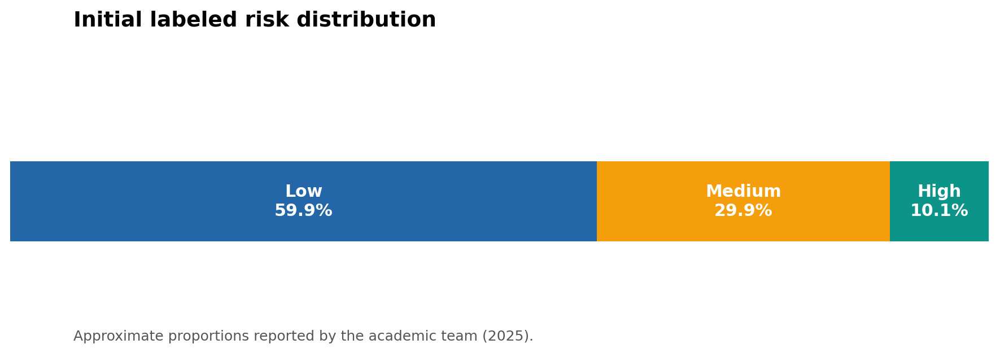
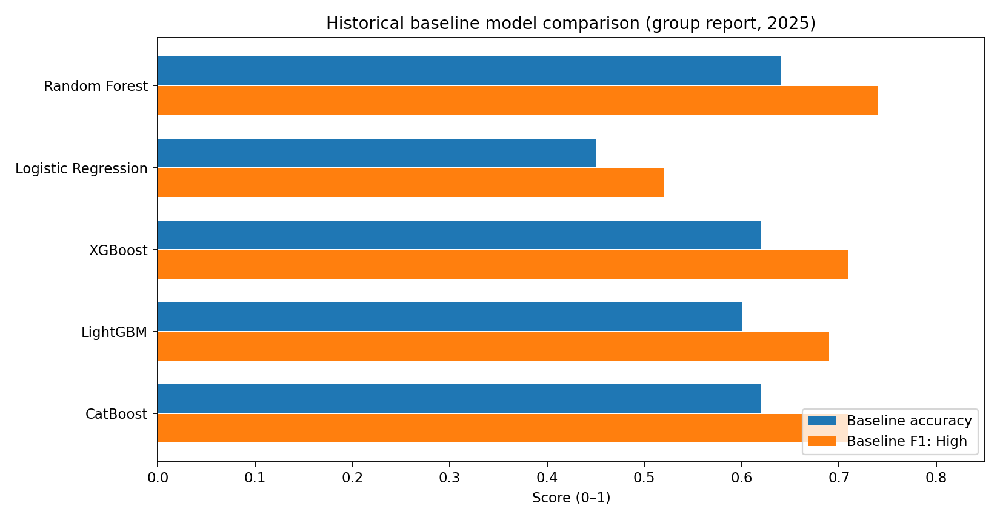
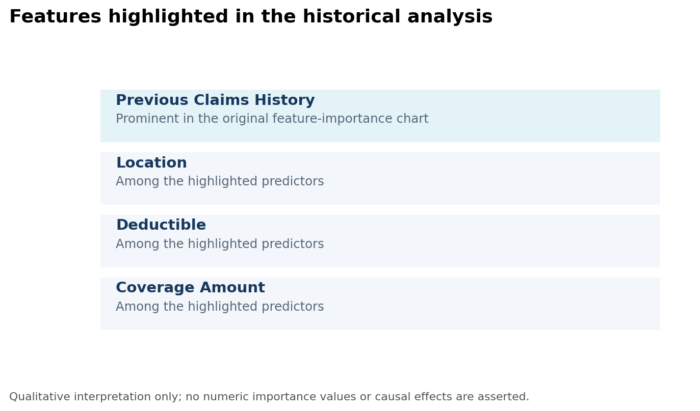
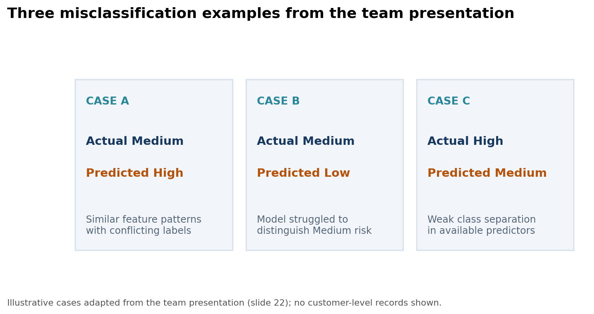
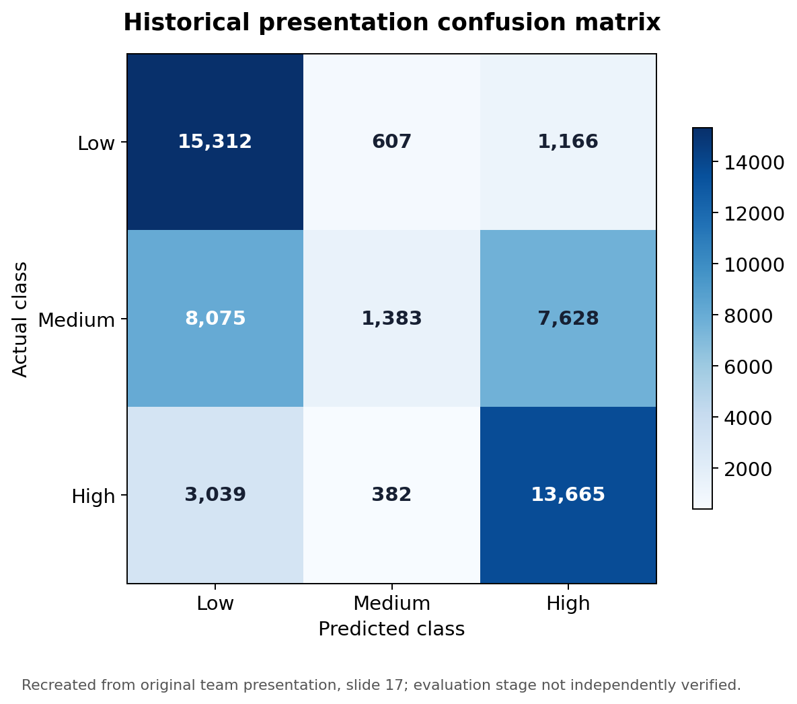

# Insurance Customer Risk Profiling | AXA Underwriting Case Study

**Data Science Consulting · Academic Team Project · 2025 · AirData Six Consulting**  
**Focus:** Insurance risk analytics · Multiclass classification · Model evaluation · Interpretation

> **Attribution and use:** This repository documents a five-student academic group project in an AXA case-study context. It is **not an AXA production underwriting system**. Technical work was completed collaboratively, and the original group report describes its data as **fictional/synthetic customer records**. No row-level data, internal documents, or contracts are published.

## Project overview

The team explored whether customer demographic, financial, policy, and behavioral information could support classification into **Low**, **Medium**, and **High** insurance risk groups. The goal was to investigate useful patterns, compare classification models, and communicate the limitations relevant to underwriting decisions.

**Business question:** Which risk categories can the available features distinguish, where does classification fail, and how confidently can such predictions inform an underwriting review?

### At a glance

| Dataset described | Target | Models evaluated | Strongest historical baseline | Key challenge |
|---|---|---|---|---|
| **150,000 fictional records** (142,500 labeled; 7,500 unlabeled) | **3 risk classes** | **5 algorithms** | **Random Forest: 0.64 accuracy; 0.74 F1 on High** | **Medium** class discrimination |

The figures above are **historical results reported by the group**, not results re-executed in this repository. The final tuned evaluation is reported separately below.

## Business context and analytical objectives

Insurance underwriting involves evaluating the characteristics and potential risks associated with prospective policyholders. In this academic case study, the team aimed to:

1. Explore risk-group differences across customer and policy attributes.
2. Build and compare machine-learning classification models.
3. Identify features highlighted by model interpretation.
4. Evaluate class-specific errors and explain whether results are suitable for decision support.

These are **project objectives**, not evidence of a deployed insurance solution or measured business improvements.

## Dataset understanding

The group report describes **150,000 fictional customer records**, of which **142,500** had risk labels and **7,500** were unlabeled. The labeled risk categories were approximately **60% Low / 30% Medium / 10% High**. Original features covered customer demographics, coverage and premium information, policy attributes, previous claims, and behavioral indicators.

**EDA takeaway:** The target was imbalanced, and the report discusses limited separation between predictor distributions across risk classes. The observed similarity of input patterns can make otherwise plausible models difficult to interpret as reliable underwriting classifiers. The synthetic nature of the dataset also constrains generalization to real customers.

> **Data governance:** Although the report characterizes customers as fictional, the original dataset has not been republished. Reuse requires checking applicable sharing permissions.

## Methodology documented by the team

1. **Data understanding and EDA:** examine distributions, missing values, and relationships between variables and risk groups.
2. **Preprocessing and feature engineering:** handle missing categories, create policy-duration and ratio features, encode categorical attributes, and scale selected values.
3. **Class balancing:** address the unequal risk-class distribution in the historical experimentation.
4. **Model benchmarking:** compare Random Forest, Logistic Regression, XGBoost, LightGBM, and CatBoost.
5. **Model assessment:** inspect per-class F1, accuracy, confusion matrix, cross-validation, and feature importance.
6. **Optimization and interpretation:** tune Random Forest in the historical workflow and review classification weaknesses.

**Important methodological qualification:** The original notebook performs SMOTE **before** the train/validation split and includes preprocessing operations outside appropriately isolated training folds. Consequently, historical scores can be affected by data leakage. See [Methodological limitations and revised pipeline](#methodological-limitations-and-revised-pipeline).

## Historical baseline model comparison

| Model | Accuracy | F1 Low | F1 Medium | F1 High |
|---|---:|---:|---:|---:|
| **Random Forest** | **0.64** | 0.70 | **0.38** | **0.74** |
| Logistic Regression | 0.45 | 0.54 | 0.22 | 0.52 |
| XGBoost | 0.62 | 0.74 | 0.21 | 0.71 |
| LightGBM | 0.60 | 0.74 | 0.15 | 0.69 |
| CatBoost | 0.62 | 0.74 | 0.19 | 0.71 |

The team selected **Random Forest** based on its historical class-wise results. The **0.74 F1 on High** is from the **baseline comparison** and must **not** be confused with the tuned-model result.

**Separate tuned-model evaluation reported in the final group report:** validation accuracy approximately **0.59**, macro F1 approximately **0.51**, and High-class F1 approximately **0.69**. These results came from the historical workflow and are **not independent, leakage-free validation**.

## Key findings and business insights

### 1. Class-level performance matters more than a single overall accuracy

The Random Forest baseline showed **F1 0.74 for High** but only **0.38 for Medium**. This means a headline accuracy figure conceals major differences in how the model handles individual groups. **Underwriting implication:** evaluation should distinguish missed high-risk cases from risk overestimation, and use per-class precision, recall, and error costs rather than accuracy alone.

### 2. Previous claims history emerged as a prominent feature

The group's feature-importance analysis highlighted **Previous Claims History**; the original chart also prominently displayed **Location**, **Deductible**, and **Coverage Amount**. This is a **model-specific historical association**, not evidence that these variables causally determine an individual's risk or are appropriate for real underwriting use.

### 3. Similar customer profiles did not always imply the same risk label

The report described near-identical combinations of predictors across different risk groups. This weak class separation is consistent with the difficulty of predicting the **Medium** category. The team explored misclassifications to communicate the limits of the available information rather than simply reporting a winning algorithm.

**Business implication:** Data quality, class definition, feature availability at decision time, and consistency of labeling need attention before attempting any operational underwriting application.

## Error analysis: historical confusion matrix

The team's presentation included this confusion matrix to show errors across the three categories. It is recreated below **exactly from the displayed cell counts**, with class codes interpreted as Low (0), Medium (1), High (2).

The presentation's confusion matrix and the final written report's tuned-summary metrics are **not fully reconcilable from the supplied materials**. Therefore, this chart is explicitly labeled a **historical presentation artifact**, not a verified result of the revised notebook or interchangeable evidence of the tuned evaluation. The strong off-diagonal counts for the Medium row illustrate the core analytical concern.

## Methodological limitations and revised pipeline

This case study is a learning and analysis artifact, **not a validated underwriting decision engine**. Specific limitations include:

- **Potential leakage:** the original notebook applied SMOTE before splitting data; certain transformations were also fit outside training-only CV.
- **Encoding:** ordinal integer encodings of nominal attributes may introduce misleading numerical order.
- **Class separability:** substantial feature overlap, particularly around Medium risk.
- **Representativeness and fairness:** fictional inputs and unexamined bias/chronology limit real-world applicability.
- **Metric provenance:** historic baseline and tuned reported scores must remain separate.

The repository therefore includes two notebooks:

| Notebook | Purpose | Status |
|---|---|---|
| [Original reference](notebooks/risk_profiling_original_reference.ipynb) | Preserve the team's historical workflow; saved outputs cleared | Historical, **not recommended for reuse as-is** |
| [Revised pipeline](notebooks/risk_profiling_revised.ipynb) | Illustrate data splitting before preprocessing, train-only imputation/one-hot encoding and oversampling inside an `imblearn` pipeline | **Unexecuted**; no new metrics claimed |

The revised example uses **RandomOverSampler** in place of the original SMOTE interpolation to avoid generating interpolated one-hot categorical vectors. **It has not been run on authorized project data.** Any newly produced metrics must be reported separately after proper execution and validation.

## Repository guide

| File or folder | Contents |
|---|---|
| [`notebooks/risk_profiling_original_reference.ipynb`](notebooks/risk_profiling_original_reference.ipynb) | Historical team workflow (cell outputs removed) |
| [`notebooks/risk_profiling_revised.ipynb`](notebooks/risk_profiling_revised.ipynb) | Leakage-aware example to execute only with authorized data |
| [`images/`](images/) | Recreated visuals from group results and presentation |
| [`reports/PROJECT_SUMMARY.md`](reports/PROJECT_SUMMARY.md) | Public summary and scope notes |
| [`requirements.txt`](requirements.txt) | Suggested dependencies |
| [`data/README.md`](data/README.md) | Data-sharing and local path guidance |

### Running the revised notebook

1. Obtain explicit authorization to access the dataset and store it locally at `data/Insurance Data.xlsx` (not tracked by Git).
2. Install requirements with `pip install -r requirements.txt`.
3. Start Jupyter from the repository root (`jupyter lab`) and open the **revised** notebook.
4. Run and critically review the new output, including leakage controls, validation design, class-wise metrics, and input-data availability.

**No public dataset or reproducible performance claim is included here.**

## Technologies

Python · Pandas · NumPy · Scikit-learn · Imbalanced-learn · Random Forest · XGBoost · LightGBM · CatBoost · Optuna · Matplotlib · Seaborn

## Team contribution and recognition

This was a **five-member collaborative project** under **AirData Six Consulting**. Technical activities—including EDA, preprocessing, feature engineering, model development, evaluation, interpretation, documentation, and presentation—were completed collaboratively. This personal portfolio entry **does not claim sole authorship**.

The team also received a **Best Presentation** recognition during the academic activity. This is a team recognition; no individual award certificate is asserted or included.

## Sources, scope and confidentiality

All baseline tables and qualitative findings are based on the **2025 group report and presentation**. Visuals are simplified reproductions of those materials; they are not independently regenerated from source records. The underlying data, group report, original AXA-branded slides, and internal documents are deliberately excluded. No accuracy improvement, production deployment, or real customer underwriting impact is claimed.
